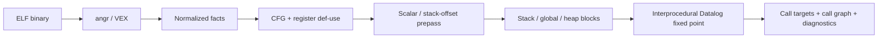

# BPA · Block-based Points-to Analysis

面向 ELF 二进制的块级指针分析研究原型：通过 **angr / VEX IR** 提取程序语义，使用 **Soufflé Datalog** 联合求解指针值传播、过程间调用关系与间接调用目标。

项目采用 BPA / BPA-X 的内存块分析思路，并加入 BinPointer 启发的 **0-base 块内偏移分析**。默认跟踪“块＋偏移”，同时提供块级基线作对照。当前使用 **facts schema v2＋offset 扩展 v1**，Python 环境与依赖由 **uv** 管理。

[环境要求](#环境要求) · [快速开始](#快速开始) · [算法逐步推导](docs/ALGORITHM_WALKTHROUGH.md) · [偏移分析与实测](docs/OFFSET_ANALYSIS.md) · [项目结构](#项目结构) · [使用方法](#使用方法) · [输出说明](#输出说明) · [回归测试](#回归测试) · [当前限制](#当前限制)

## 功能概览

- **统一中间表示**：将 VEX 中的寄存器读写、内存访问、表达式与调用目标转换为 TSV facts。
- **寄存器定义追踪**：按基本块和 VEX 语句顺序建立定义与读取关系，区分覆盖赋值前后的寄存器值。
- **块与偏移分析**：用块身份、字节偏移与访问宽度连接 store / load，区分可恢复的字段位置；未知偏移保守合并，支持全局初始化函数指针。
- **过程间分析**：连接参数与返回寄存器，在同一个 Datalog 不动点中更新值集和调用图。
- **诊断与评估**：输出未解析调用、未知语义提示，并可利用 DWARF 评估内存块边界。

### 分析流程



## 环境要求

| 组件 | 要求 | 用途 |
| --- | --- | --- |
| 操作系统 | Linux x86_64；Windows 可使用 WSL2 | 原生分析与测试 |
| Python | CPython **3.12**，由 uv 管理 | 运行分析工具 |
| uv | 已验证 **0.13.3** | Python 安装、虚拟环境与依赖锁定 |
| Soufflé | 已验证 **2.5**，64 位 word | 执行 Datalog 规则 |
| GCC / binutils | 已验证 GCC **13.3** | 编译与检查测试程序 |
| Bash / Git / curl / file | 常规 Linux 工具 | 运行入口、获取代码与批量分析 |
| 32 位开发库 | 运行完整回归时需要 | 编译、执行 x86 样例 |
| GNU time | 可选，Linux `/usr/bin/time` | 测量求解命令峰值 RSS；缺失时该指标为 `null` |

分析已有 ELF 时无需重新编译。**uv 仅管理 Python 环境，不安装 Soufflé、GCC 或系统开发库。**

### 1. 安装系统工具

Ubuntu / Debian 示例：

```bash
sudo apt update
sudo apt install -y git curl build-essential binutils file
```

完整回归同时包含 x86 和 x64 程序，需额外安装：

```bash
sudo apt install -y gcc-multilib libc6-dev-i386
```

### 2. 安装 Soufflé

按 [官方安装指南](https://souffle-lang.github.io/install) 安装适配当前系统的发行包，或从源码构建。预编译包可从 [官方 Releases](https://github.com/souffle-lang/souffle/releases) 获取。

确认引擎可用，并检查输出中的版本与 word size：

```bash
souffle --version
```

若引擎没有加入 PATH，可指定其绝对路径：

```bash
export SOUFFLE=/absolute/path/to/souffle
```

### 3. 安装 uv

Linux / WSL2：

```bash
curl -LsSf https://astral.sh/uv/install.sh | sh
export PATH="$HOME/.local/bin:$PATH"
uv --version
```

其他安装方式见 [uv 官方文档](https://docs.astral.sh/uv/getting-started/installation/)。

## 快速开始

### 获取代码与创建环境

```bash
git clone https://github.com/dnffabs/BPA.git
cd BPA

uv python install 3.12
uv sync --locked
uv run --locked python --version
```

uv 根据 `.python-version` 选择 Python，在项目根目录创建独立的 `.venv`，并按 `uv.lock` 安装依赖。使用 `uv run` 时无需手动激活环境。

### 编译并分析自带 demo

```bash
mkdir -p build

gcc -O0 -g -fno-pie -no-pie -fno-omit-frame-pointer \
    pipeline/bin/test.c -o build/demo

# 运行样例，检查其原生行为
./build/demo

# 执行分析，并使用编译时保留的 DWARF 做边界评估
uv run --locked ./pipeline/run.sh build/demo \
    --output build/demo-analysis \
    --compare
```

查看执行状态和间接调用候选：

```bash
cat build/demo-analysis/summary.json
cat build/demo-analysis/facts/indirect_call_target.facts
```

`summary.json` 的 `status: completed` 表示流水线执行成功。是否找全目标、是否存在额外候选，需要结合目标文件与诊断结果判断。当前保守内存抽象可能在同一调用点同时给出 `add`、`sub` 两个候选。

## 项目结构

下面列出当前主流水线涉及的文件。各阶段通过 `facts/` 中的同名关系传递数据。

```text
BPA/
├── README.md                         # 项目入口文档
├── pyproject.toml                    # Python 版本约束与直接依赖
├── uv.lock                           # uv 生成的依赖锁文件
├── .python-version                   # Python 版本请求：3.12
├── requirements.txt                  # 从 uv.lock 导出的兼容依赖列表
│
├── pipeline/                         # Shell 运行入口
│   ├── run.sh                        # 单个 ELF 的完整分析
│   ├── run_all.sh                    # 批量分析目录中的 ELF
│   ├── common.sh                     # 统一选择 Python 解释器
│   ├── preprocess.sh                 # 预处理及其前置步骤
│   ├── cfg.sh                        # CFG 阶段及其前置步骤
│   ├── ssa.sh                        # 定义与读取关系及其前置步骤
│   ├── boundary_gen.sh               # 内存块生成及其前置步骤
│   ├── analysis.sh                   # 值分析及其前置步骤
│   ├── compare.sh                    # 分析与可选 DWARF 评估
│   └── bin/test.c                    # 自带 C demo
│
├── tools/                            # Python 分析工具
│   ├── run_pipeline.py               # 阶段调度、执行摘要与日志
│   ├── generate_facts.py             # ELF / CFG / VEX 事实提取
│   ├── memory_model.py               # 有限标量、栈偏移与分配点预分析
│   ├── offset_model.py               # 精确值完整性认证与位移输入
│   └── vex2Datalog/
│       ├── parser.py                 # VEX 表达式和语句转换
│       └── DatalogFacts.py           # ID 分配及 TSV facts 写出
│
├── rules/                            # Soufflé 规则
│   ├── schema.dl                     # schema v2 输入数据契约
│   ├── preprocess.dl                 # 函数视图
│   ├── cfg.dl                        # 函数内 CFG
│   ├── ssa.dl                        # reaching definitions / def-use
│   ├── stack_boundary.dl             # 栈帧块
│   ├── global_boundary.dl            # 全局 section 块
│   ├── heap_boundary.dl              # 堆分配点块
│   ├── aloc_gen.dl                   # 抽象内存位置 ID
│   ├── offset_memory.dl              # 0-base 偏移传播、读写重叠及栈参数摘要
│   └── analysis.dl                   # 指针、内存、调用图的联合求解
│
├── compare/                          # DWARF 真值提取与边界评估
│   ├── extract_dwarf_gt.py
│   └── evaluate.py
├── tests/
│   ├── fixtures/                     # 各分析能力的 C 样例
│   ├── run_all.py                    # 完整回归与机器可读验证摘要
│   ├── run_regressions.py            # 基础语义与原生流程回归
│   ├── test_memory_model.py          # 32/64 位栈位移
│   ├── test_offset_rules.py          # 偏移规则与未知值反例
│   ├── test_offsets.py               # 三种模式的原生精度与性能对照
│   └── test_pipeline_resources.py    # 峰值内存统计独立性
├── docs/
│   ├── ALGORITHM_WALKTHROUGH.md       # 从分块到调用目标的样例推导与实测
│   ├── OFFSET_ANALYSIS.md             # 默认偏移模式、限制与回归结果
│   ├── FACTS.md                      # facts 字段与语义
│   ├── REQUIREMENTS.md               # 环境配置与故障排查
│   └── examples/callback_walkthrough.c # 基础回调及覆盖赋值对照样例
└── build/                            # 编译产物、facts、日志与评估；不提交
```

`tools/Demo/`、旧地址提取脚本和其他历史文件保留供研究参考，不参与当前主流程。schema v1 的历史 facts 需重新生成后才能用于当前规则。

## 使用方法

以下命令均在项目根目录执行。

### 分析自己的程序

```bash
uv run --locked ./pipeline/run.sh /path/to/program \
    --output build/program-analysis \
    --entry main \
    --jobs 4
```

| 参数 | 默认值 | 说明 |
| --- | --- | --- |
| `binary` | 必填 | 待分析 ELF 路径 |
| `--output`, `-o` | `build/<名称>_<路径哈希>_dir` | 保存本次分析产物 |
| `--entry` | `main` | 分析入口函数名 |
| `--jobs`, `-j` | `4` | Soufflé 线程数 |
| `--memory-model` | `offset` | `block` 块级对照；`heap-offset` 仅堆启用偏移；`offset` 全部内存启用偏移 |
| `--compare` | 关闭 | 使用 DWARF 评估内存边界 |
| `--stage` | `analysis` | 执行至指定阶段，包含其前置步骤 |

阶段顺序为 `preprocess → cfg → ssa → boundary_gen → analysis`；启用 `--compare` 后继续执行 `compare`。

三种模式使用相同的块划分、前端和输入二进制。对比时为每种模式指定不同的输出目录，例如：

```bash
uv run --locked ./pipeline/run.sh build/demo --memory-model block --output build/demo-block
uv run --locked ./pipeline/run.sh build/demo --memory-model heap-offset --output build/demo-heap-offset
uv run --locked ./pipeline/run.sh build/demo --memory-model offset --output build/demo-offset
```

仅堆启用偏移时，栈中的粗别名仍可能污染堆读写。字段、重复覆盖、循环和跨函数示例见 [偏移分析与实测](docs/OFFSET_ANALYSIS.md)。

输入需保留 `.symtab` 中已定义函数的入口与大小。DWARF 调试信息仅用于 `--compare`：没有 DWARF 时跳过评估，主分析仍可运行；完全 stripped 的输入会明确报错。

### 单独执行某一阶段

```bash
uv run --locked ./pipeline/ssa.sh build/demo build/ssa-demo
```

阶段入口会重新执行必要的前置步骤，不会把旧 facts 当成已验证缓存。

### 批量分析

```bash
uv run --locked ./pipeline/run_all.sh /path/to/binaries
```

批量入口分析目录第一层的 ELF 文件，使用默认入口 `main`。任一分析失败时，汇总失败数量并返回非零退出码。

## 输出说明

```text
build/program-analysis/
├── summary.json              # 输入 SHA256、阶段耗时、目标数与诊断摘要
├── facts/                    # 中间关系与最终分析结果
├── *.log                     # 各阶段日志
└── evaluation/               # 启用 --compare 时生成
    ├── gt_metadata.json
    ├── stack_gt.tsv
    ├── global_gt.tsv
    └── report.txt            # 存在 DWARF 时生成的评估报告
```

| 文件（位于 `facts/`） | 含义 |
| --- | --- |
| `indirect_call_target.facts` | 调用点十进制地址、候选用户函数名 |
| `external_call_target.facts` | 调用点地址、候选外部函数名 |
| `call_graph.facts` | 调用者、被调函数、调用点地址 |
| `interproc_edge.facts` | 过程间调用边与返回边 |
| `ssa_def.facts` / `ssa_use.facts` | 寄存器定义版本与读取关系 |
| `def_use.facts` | 定义版本到读取表达式的连接 |
| `stack_aloc.facts` / `global_aloc.facts` / `heap_aloc.facts` | 三类抽象内存块 |
| `points_to_offset.facts` | 表达式、块、偏移种类、字节偏移 |
| `memory_code_offset.facts` / `memory_pointer_offset.facts` | 带位置与访问宽度的函数地址、数据指针；指针目标也携带偏移 |
| `memory_unknown_offset.facts` | 无法完整建模的内存内容及其位置 |
| `points_to.facts` | 移除偏移后的块级投影，用于兼容和查看 |
| `memory_code.facts` / `memory_pointer.facts` | 移除位置后的块级内容投影；不能据此判断字段是否混合 |
| `store_to_aloc.facts` / `load_from_aloc.facts` | 内存访问与候选块的映射 |
| `call_resolution.facts` | 所有可达间接调用点及其用户、外部目标数，保留空结果 |
| `unresolved_call.facts` | 尚未解析出目标的间接调用点 |
| `uncertain_call.facts` | 受 unknown 语义影响的调用点，可能已解析出部分目标 |
| `unsupported.facts` | 尚未完整建模的语句或表达式 |

facts 为无表头 TSV。空目标集应结合 `unresolved_call`、`uncertain_call` 和日志理解，不能据此认定运行时没有调用。完整字段定义见 [FACTS.md](docs/FACTS.md)。

`summary.json` 的 `analysis_resources` 记录最终 Soufflé 求解命令的墙钟耗时和峰值 RSS（KiB，包含预处理器），不代表整个 Python / angr 流水线的内存。`stages` 记录各阶段耗时，`offsets` 记录偏移事实数量。峰值 RSS 通过可选 GNU time 测量，缺失时为 `null`。

## 回归测试

先安装前述 32 位开发库，再执行：

```bash
uv run --locked python tests/run_all.py
```

回归会实际编译、运行并分析 x86 / x64 样例，同时覆盖 AMD64 PIE。测试内容包括寄存器覆盖赋值、临时变量隔离、块内先读后写、偏移累计、内存别名、参数与返回值、间接工厂调用、全局初始化指针、堆回调、分支循环、PLT 和错误输入处理。

完整验证结果保存到 `build/validation/results.json`，包括状态、失败详情、代码版本与各模式指标；基础案例在 `build/regressions/results.json`，偏移对照在 `build/offset-regressions/results.json`。只有完整对照且所有断言通过时，偏移报告才标记 `completed`。寄存器与单参数回调案例检查目标集合精确相等；保守内存案例检查预期目标均被找到，并单独统计额外候选。

也可单独运行 `tests/run_regressions.py`、`tests/test_memory_model.py`、`tests/test_offset_rules.py`、`tests/test_offsets.py` 或 `tests/test_pipeline_resources.py`。完整回归涵盖 17 次基础原生分析，以及 9 个偏移测试二进制 × 3 种模式的 27 次对照；这些是固定小样例的验证结果。

## 使用 uv 管理环境

| 文件 | 职责 |
| --- | --- |
| `.python-version` | 选择 Python `3.12` 系列 |
| `pyproject.toml` | 声明 `>=3.12,<3.13` 与直接依赖约束 |
| `uv.lock` | 锁定直接和传递依赖的具体版本；应提交到 Git |
| `.venv/` | uv 创建的本地虚拟环境；不提交到 Git |
| `requirements.txt` | 兼容导出；通过 uv 重新生成，不单独维护 |

常用命令：

```bash
# 按锁文件重建/同步环境
uv sync --locked

# 查看实际解释器和依赖树
uv run --locked python --version
uv tree --locked

# 在当前版本约束内更新依赖；更新后重新运行回归
uv lock --upgrade
uv sync --locked

# 更新兼容依赖列表
uv export --locked --no-hashes --no-emit-project \
    --output-file requirements.txt
```

`.python-version` 的 `3.12` 固定主次版本，不固定补丁版本。若实验需精确复现某个补丁版本，可用 `uv python pin 3.12.15` 等命令写入完整版本号，并与 `pyproject.toml` 的范围保持一致。uv 的版本选择与锁定机制见 [官方项目指南](https://docs.astral.sh/uv/guides/projects/)。

## 当前限制

- 当前主要支持 Linux AMD64 / X86 ELF，依赖函数符号；完整 stripped 函数恢复尚未实现。
- 寄存器区分定义版本；内存采用流不敏感弱更新，过程间分析上下文不敏感。
- 每个函数一个栈帧块、每个全局 section 一个块；堆按分配点建块。默认在块内保留可证明的偏移，重复位移、未知索引、无法恢复的栈对齐等仍会退化，产生额外候选。
- 栈参数按可读参数槽接收调用者帧内容，尚未逐个匹配实参槽；同一分配点的动态对象仍合并。`memcpy` / `realloc` 等摘要暂将目的位置退化为未知，未精确建模复制字节范围。
- X86 堆分配大小暂以 unknown 保留；仅有基础分配器与部分内存函数摘要。
- 尚未完整覆盖 C++、异常、尾调用、全部 VEX 操作、库函数副作用、外部回调，以及动态分配器函数指针。
- 回归结果只描述当前测试集。本项目是研究基线，尚不提供对任意二进制的 soundness 保证。

## 进一步阅读

- [从内存分块到间接调用目标：算法逐步推导](docs/ALGORITHM_WALKTHROUGH.md)
- [0-base 偏移分析、模式对照与验证结果](docs/OFFSET_ANALYSIS.md)
- [环境配置与故障排查](docs/REQUIREMENTS.md)
- [Facts schema v2](docs/FACTS.md)
- [angr](https://angr.io/) · [Soufflé](https://souffle-lang.github.io/) · [uv](https://docs.astral.sh/uv/)
