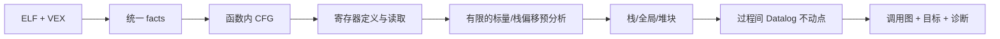

# BPA：可运行的二进制指针分析基线

本仓库使用 angr/VEX 提取二进制语义，以 Soufflé 做寄存器 def-use、内存块 points-to 和过程间间接调用目标分析。当前实现是 **schema v2 基础版本**，不是 BPA-X 论文的完整复现。

## 本机快速运行

```bash
cd /home/qc/Desktop/binwork/mywork/BPA
mkdir -p build
gcc -O0 -g -fno-pie -no-pie -fno-omit-frame-pointer \
    pipeline/bin/test.c -o build/demo
./pipeline/run.sh build/demo --output build/demo-analysis --compare
```

结果在 `build/demo-analysis/facts/`；执行状态和输入 SHA256 在 `build/demo-analysis/summary.json`。

- `indirect_call_target.facts`：`调用点十进制地址<TAB>用户目标函数名`。
- `call_graph.facts`：调用者、被调函数、调用点，包含新解析出的间接调用边。
- `interproc_edge.facts`：调用与返回边。
- `ssa_def/ssa_use/def_use.facts`：定义版本和读取关系。
- `points_to/memory_code/memory_pointer.facts`：表达式及内存块的值。
- `store_to_aloc/load_from_aloc.facts`：真实接入值分析的内存访问映射。
- `call_resolution.facts`：每个可达间接调用点、所属函数、用户目标数、外部目标数，保留未解析点。
- `external_call_target.facts`：外部调用目标，单独于用户函数目标输出。
- `unresolved_call.facts`：尚未找到目标的可达间接调用。
- `uncertain_call.facts`：目标表达式受 unknown 语义影响的调用，即使已找到部分目标也会保留提示。
- `unsupported.facts`：当前没有完整语义模型的语句/表达式。空目标集合不能解释为运行时不会发生调用。

`--compare` 可选；有 DWARF 时，评估输出在本次目录的 `evaluation/` 中。没有 DWARF 时明确跳过，不读取其他程序留下的 GT。主分析仍需 `.symtab` 中定义的函数入口与大小；完全 stripped 的输入会明确报错。

## 流程



`analysis.dl` 内联合求解：值集 → 新调用目标 → 实参/形参和返回值流 → 新值集。因此不依赖多次重跑不相连的 shell 阶段。函数内 CFG 与 def-use 已给所有调用位置预置 ABI 读取/返回版本，新增被调函数时无需重新分配这些版本。

## 当前支持与精度边界

- 原生验证覆盖 Linux AMD64、X86，以及 AMD64 PIE。
- 寄存器按定义版本区分；同一机器指令内使用 VEX 语句顺序区分定义与读取。
- 内存使用流不敏感的弱更新，上下文不敏感。
- 保守基线默认每个函数一个栈帧块、每个全局 section 一个块；堆按直接识别到的分配调用点建块。这能避免数组内部地址被误切，但会产生额外候选。
- 栈块数值范围用于描述已观察到的地址；抽象身份代表整个函数帧，未知偏移不会因超出描述范围而被删除。
- 调用参数通过寄存器连接；栈参数采用保守的帧内容传递。栈对象、函数上下文、字段均未进一步区分。
- `malloc/calloc/realloc` 有返回指针模型；AMD64 的已知大小按各自 ABI 参数计算。X86 暂保留未知分配大小。支持基础 realloc 内容转移和 AMD64 memcpy/memmove/strcpy/memset 返回值摘要。
- 尚未实现完整 stripped 函数恢复、C++/异常/尾调用、全部 VEX 操作、全部库函数副作用/外部回调、通过动态分配器函数指针创建堆块。
- 对未知操作保留诊断；本版本不声称对任意二进制 sound，也不将本次小例子的召回率外推到大型程序。

## 回归验证

```bash
.venv/bin/python tests/run_regressions.py
```

测试会实际编译、运行并分析样例，检查预期目标是否被找到；寄存器覆盖和单参数回调还检查没有额外目标。结果保存为 `build/regressions/results.json`。在限制 32 位系统调用的沙箱中，32 位程序会收到 SIGSYS；应从本机普通终端运行整个测试。

测试包括：寄存器覆盖、先读后写、同指令多个定义、临时变量命名空间、Unop、偏移累计、块内访问、参数/返回值、间接工厂调用、全局初始化指针、堆字段、calloc/realloc、栈传参、分支循环、传统 PLT、未知目标和 stripped 输入失败处理。

## 环境

本机 `.venv` 复用此前已经安装的 BPA-X 环境；该链接和所有 build 产物均不进入 Git。换机可创建自己的 `.venv`：

```bash
python3 -m venv .venv
.venv/bin/python -m pip install -r requirements.txt
```

运行入口按 `BPA_PYTHON` → 仓库 `.venv/bin/python` → PATH 的 `python3` 查找解释器。Soufflé 按 `SOUFFLE` → PATH → 当前研究工作区的 `souffle` 查找。

```bash
BPA_PYTHON=/path/to/venv/bin/python SOUFFLE=/path/to/souffle \
  ./pipeline/run.sh /path/to/program
```

详见 [facts 数据契约](docs/FACTS.md)、[环境要求](docs/REQUIREMENTS.md)、[修复与验证记录](docs/REPAIR_VALIDATION.md)。旧的 `tools/Demo/`、`tools/local_address.py` 等 schema v1 原型不属于当前主流水线；旧 facts 必须重新生成，不能混用于 v2 规则。
