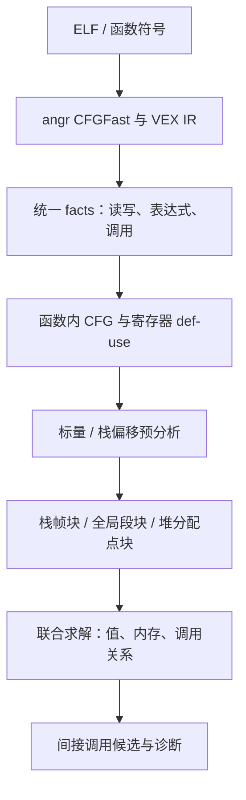
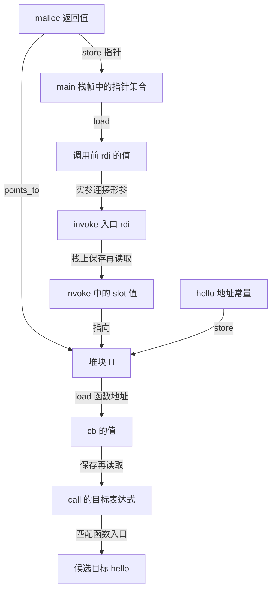

# 从内存分块到间接调用目标：块级基线的逐步推导

本文用一个小程序说明：**仓库的块级基线如何把二进制中的地址读写，逐步转成“这个间接调用可能调用哪些函数”。**

本文记录 2026-10-20 的块级基线，使用 facts schema v2。下文的“当前实现”与 facts 实测均指该基线，不能直接等同于 BPA / BPA-X 论文的全部算法和能力。

**2026-10-26 更新：默认模式已加入块内偏移，本文的块内容合并规则用 `--memory-model block` 对照。最新的读写关系、栈参数处理、字段区分及实测见 [OFFSET_ANALYSIS.md](OFFSET_ANALYSIS.md)。基础的定义版本、种子和调用图不动点流程仍可按本文学习。**

建议第一次按第 1～10 节阅读，先理解主线；再看实际 facts、精度损失与代码定位。

## 目录

1. [先看最小例子](#1-先看最小例子)
2. [二进制里实际发生了什么](#2-二进制里实际发生了什么)
3. [分块前的准备：基本块和寄存器定义](#3-分块前的准备基本块和寄存器定义)
4. [内存分块：为地址建立共同的身份](#4-内存分块为地址建立共同的身份)
5. [开始传播前：区分几种值和关系](#5-开始传播前区分几种值和关系)
6. [逐步推导：从 malloc 到 heap 中的 hello](#6-逐步推导从-malloc-到-heap-中的-hello)
7. [跨函数：main 的参数怎样进入 invoke](#7-跨函数main-的参数怎样进入-invoke)
8. [从 load 到 call rax：目标怎样被找出来](#8-从-load-到-call-rax目标怎样被找出来)
9. [返回值怎样传回调用者](#9-返回值怎样传回调用者)
10. [为什么要反复传播，什么时候结束](#10-为什么要反复传播什么时候结束)
11. [实际运行与 facts 对照](#11-实际运行与-facts-对照)
12. [只加一次覆盖赋值，为什么会多出目标](#12-只加一次覆盖赋值为什么会多出目标)
13. [流敏感、路径敏感、上下文敏感分别解决什么](#13-流敏感路径敏感上下文敏感分别解决什么)
14. [全局变量如何进入同一流程](#14-全局变量如何进入同一流程)
15. [如何判断最终结果的含义](#15-如何判断最终结果的含义)
16. [代码地图与排查顺序](#16-代码地图与排查顺序)

## 1. 先看最小例子

完整可编译源码是 [examples/callback_walkthrough.c](examples/callback_walkthrough.c)。先忽略其中的 `OVERWRITE` 条件编译部分，基础版等价于：

```c
#include <stdlib.h>

typedef int (*Callback)(void);

__attribute__((noinline)) int hello(void) {
    return 7;
}

__attribute__((noinline)) int invoke(Callback *slot) {
    Callback cb = *slot;
    return cb();
}

int main(void) {
    Callback *slot = malloc(sizeof(*slot));
    if (!slot) return 2;

    *slot = hello;
    int result = invoke(slot);
    free(slot);
    return result != 7;
}
```

`noinline` 用于让这个教学例子保留独立的函数调用，便于观察。

### 1.1 先把几个符号翻译成人话

| 代码 | 含义 |
| --- | --- |
| `Callback` | 一种函数指针类型：指向“无参数、返回 int”的函数 |
| `Callback cb` | `cb` 存放一个函数地址 |
| `Callback *slot` | `slot` 指向一个内存位置；这个位置里可以存放函数地址 |
| `malloc(sizeof(*slot))` | 申请足以放下一个函数指针的空间；本次 AMD64 编译为 8 字节 |
| `*slot = hello` | 把 `hello` 的函数地址写入这片空间 |
| `Callback cb = *slot` | 读出里面保存的函数地址，赋给 `cb` |
| `cb()` | 跳到 `cb` 中的地址执行，即间接调用 |

这里有两个不同的问题：

1. **`slot` 指向哪里？** 指向申请到的堆空间。
2. **那片空间里存了什么？** 存了 `hello` 的函数地址。

先找到空间，再找到内容，就能解释最后的调用。

### 1.2 真实运行时的过程

假设分配成功，程序依次做这些事：

```text
申请一片堆空间
    ↓
main.slot 保存这片空间的地址
    ↓
向这片空间写入 hello 的地址
    ↓
把空间地址作为参数交给 invoke
    ↓
invoke 读取该空间，得到 hello 的地址
    ↓
cb() 调用 hello，返回 7
```

`main` 和 `invoke` 中的 `slot` 是两个局部变量。传参之后，它们保存的指针值相同，指向同一片堆空间；并没有复制出第二片堆空间。

静态分析要在不运行目标程序的情况下，重建上面这条关系。对于本例，堆的运行时数值地址可以未知，最后的函数目标仍可以推导为 `hello`。

## 2. 二进制里实际发生了什么

分析入口接收的是编译后的 ELF。源码用于帮助我们理解和核对结果。

本次基础版的关键机器指令如下，省略了检查、函数序言和收尾：

```asm
; main
0x401194: mov edi, 8
0x401199: call malloc@plt
0x40119e: mov [rbp-8], rax       ; 保存 malloc 返回的堆指针
...
0x4011b0: mov rax, [rbp-8]       ; 重新读出堆指针
0x4011b4: mov [rax], 0x401156    ; 向堆空间写入 hello 的地址
0x4011bb: mov rax, [rbp-8]
0x4011bf: mov rdi, rax           ; 第一个参数
0x4011c2: call invoke

; invoke
0x401171: mov [rbp-24], rdi      ; 参数先保存到栈上
0x401175: mov rax, [rbp-24]      ; 读出参数，即堆指针
0x401179: mov rax, [rax]         ; 从堆中读出函数地址
0x40117c: mov [rbp-8], rax       ; 保存局部变量 cb
0x401180: mov rax, [rbp-8]       ; 读回 cb
0x401184: call rax              ; 待解析的间接调用
```

本次 `hello` 的入口地址是 `0x401156`。地址会随编译器、编译选项和代码修改而改变。

注意同一个 `rax` 被反复使用：

- `malloc` 后，`rax` 是堆指针。
- `mov rax, [rax]` 后，`rax` 变成函数地址。
- 函数返回后，`eax` 又用于保存整数返回值。

因此，不能把整个程序中所有叫 `rax` 的值都混成一份。这正是建立寄存器定义版本的原因。

## 3. 分块前的准备：基本块和寄存器定义

### 3.1 先区分两种“块”

| 名称 | 划分的东西 | 解决的问题 |
| --- | --- | --- |
| 基本块，basic block | 指令序列 | 哪些指令可能先后执行，分支在哪里汇合 |
| 内存块，memory block | 栈、全局、堆中的存储区域 | 两次不同的地址计算是否可能访问同一个对象 |

`CFG` 是控制流图，记录基本块及其可能的转移边。本文后面的“分块”主要指内存分块。

当前流水线的真实顺序是：



也就是说，代码先建立寄存器定义关系，再用它累计栈偏移并生成内存块。概念上从分块讲值传播时，也需要知道这个前置步骤。

### 3.2 SSA 的目的：每一次赋值都拥有独立身份

先看简化的寄存器序列：

```text
rax = malloc 返回值
把 rax 保存到栈
rax = hello 地址
把 rax 写入堆
```

给定义编号以后：

```text
rax_1 = malloc 返回值
把 rax_1 保存到栈
rax_2 = hello 地址
把 rax_2 写入堆
```

后续读取究竟依赖 `rax_1` 还是 `rax_2`，就可以明确表示出来。

**SSA，Static Single Assignment，静态单赋值形式**，核心思想是让每个值的定义只发生一次。当前项目采用 SSA 风格的定义 ID 和到达定义分析：

1. 每次寄存器写入创建一个独立的定义版本。
2. 读取优先连接同一基本块内、读取之前最近的定义。
3. 块内没有更早定义时，使用沿 CFG 到达入口的定义。
4. 分支汇合处可以有多个到达定义，它们都会连接到读取。

生成的关键关系是：

```text
def_use(某次定义的版本ID, 本次读取的表达式ID)
```

它表示“这次读取可能拿到这次定义的值”。

**实现边界：** `rules/ssa.dl` 没有为每个汇合点构造一个新的显式 `phi` 表达式。`phi_node` 记录多路输入定义；值传播通过多条 `def_use` 边合并输入。这也不是内存 SSA：同一内存块不会因每次 store 而创建新版本。

### 3.3 为什么这一步还会影响分块

识别栈地址时，需要知道 `rbp`、`rsp` 是如何算出来的。例如：

```text
函数入口 rsp = S
push rbp     → rsp = S - 8
mov rbp,rsp  → rbp = S - 8
[rbp - 8]    → [S - 16]
```

`[rbp-8]` 的规范化偏移因此是 **entry-SP - 16**，不能直接记成 -8。

定义关系把这些计算串起来，`tools/memory_model.py` 再沿着它累计偏移。不同位置使用不同的 `rbp/rsp` 版本，才不会错误地混用坐标。

## 4. 内存分块：为地址建立共同的身份

### 4.1 为什么要给内存起一个抽象名字

真实运行中，`malloc` 可能返回 `0x12340000`，也可能返回另一个地址。静态分析没有必要先猜出这个数值。

本例可以把“main 中这个分配点产生的空间”命名为 `H`：

```text
main.slot   ──指向──> H
invoke.slot ──指向──> H
H           ──保存──> hello 的地址
```

`H` 是抽象身份，不是运行时地址，也不会真的分配内存。

store 使用 `rax`，load 也许使用 `rdi` 或某个临时变量。只要它们都可能指向 `H`，分析就能通过 `H` 把写入与读取接起来，不要求两次访问使用相同的寄存器名或表达式 ID。

### 4.2 当前代码到底怎样分块

| 内存种类 | 当前划分方式 | ID 示例 | 主要损失 |
| --- | --- | --- | --- |
| 栈 | 每个函数一个栈帧块 | `stk_main`、`stk_invoke` | 同一帧的局部变量、保存寄存器等内容合并 |
| 全局 | 每个受支持 ELF section 一个块 | `glb_.data`、`glb_.rodata` | 同段中的不同变量或数组元素合并 |
| 堆 | 按识别出的分配调用点建块 | `heap_main_4198809` | 同一分配点多次执行得到的对象合并 |

这里的粒度很粗。当前代码并没有恢复出“每个源码变量、结构体字段都有独立块”的完整对象布局。

本次基础版实际生成：

```text
stack_aloc(id, function, entry-SP偏移, 观测跨度)
stk_hello    hello     -8    16
stk_invoke   invoke   -32    40
stk_main     main     -20    28

heap_aloc(id, function, 分配调用点, 大小)
heap_main_4198809   main   4198809   8
```

`4198809` 是 `malloc` 调用指令地址 `0x401199` 的十进制形式。

栈块的数值区间由已识别访问的最小偏移、最大结束偏移生成，还加入入口返回地址位置。例如 `stk_main` 的观测区间为 `[-20, 8)`。**这是观测访问跨度，不等于精确恢复出的全部物理栈帧布局。** 后续 points-to 保留整帧身份，不用这个区间排除未知偏移的栈指针。

虽然源码没有自定义全局回调，ELF 自身仍有全局数据段，所以基础版也生成了 5 个全局块；主线推导不依赖它们。

### 4.3 预分析如何提供分块依据

`tools/memory_model.py` 先做一个有限的标量 / 仿射分析：

- 传播已知数字，例如函数入口地址、常数 8。
- 传播“某函数入口 SP + 偏移”，例如 `(main, -16)`。
- 支持部分加减、转换和数值运算。
- 识别已知 `malloc/calloc/realloc` 调用及其返回位置。

“仿射”在这里可以先理解为：**入口 SP 这个基准，加上一个常数偏移。**

每个表达式最多保留 8 个备选标量 / 仿射值；超过后提升为 unknown，记录在 `numeric_top.facts`。这样循环里的偏移不会无限增长。这个上限属于预分析，不是说最终每个间接调用最多只能输出 8 个目标。

这个步骤不负责完成最终的跨函数 load/store 求解。它提供 `scalar`、`affine_stack`、指针种子和分配点信息，后面的 Datalog 再联合传播。

### 4.4 不分块和分错块，具体会怎样

不分块也可以设计分析，例如跟踪字节地址、区间和偏移；只是需要其他内存抽象，并承担对应成本。对于当前这类块级算法，分块提供了内存读写的共同连接点。

| 做法 | `*slot = hello` 后如何处理 | 对后续 `*slot` 的影响 |
| --- | --- | --- |
| 只跟踪寄存器，没有内存模型 | 无处记录“目标空间里写入 hello” | load 无法从先前 store 得到函数地址 |
| 全部内存合成一个块 | 所有写入都进入同一集合 | 不相关位置的函数地址也会被读出 |
| 把相关地址映射到同一适当粒度的块 | store 和 load 通过块身份连接 | 可以恢复目标，并控制不相关值的混入 |

把块分得过粗，典型后果是**多余候选**。例如两个独立对象分别保存 `hello`、`bye`，若混成同一块，从其中一个对象读取时就可能得到两者。

把一个合法对象错误切开，也可能导致**漏目标**。假设 `p` 指向数组开头，`p+1` 仍在数组内；若切成两个块，同时指针运算规则只保留原块身份，写入地址与读取地址就可能落到不一致的抽象身份，传播链被切断。

因此，划分更细不自动代表更好。块边界必须与指针运算和读写映射规则配合。

## 5. 开始传播前：区分几种值和关系

为方便阅读，接下来使用这些教学记号：

| 记号 | 表示什么 |
| --- | --- |
| `S_main` | `stk_main` |
| `S_invoke` | `stk_invoke` |
| `H` | `heap_main_4198809` |
| `&hello` | `hello` 的代码入口地址 |
| `e_x` | 某个表达式的身份，具体数字暂时省略 |

下面的 `e_x` 是讲解用名字；第 11 节才展示本次运行的真实 EID。

### 5.1 五个核心关系

| 关系 | 读法 | 本例中的含义 |
| --- | --- | --- |
| `flow(a, b)` | a 的值可以传给 b | 复制、寄存器 def-use、实参与形参连接 |
| `points_to(e, B)` | 表达式 e 可能指向内存块 B | `slot` 指向 `H` |
| `code_value(e, A)` | 表达式 e 可能保存代码地址 A | `cb` 保存 `&hello` |
| `memory_pointer(B, C)` | 块 B 中可能存有指向 C 的指针 | 栈中的 slot 保存指向 `H` 的指针 |
| `memory_code(B, A)` | 块 B 中可能存有代码地址 A | `H` 中保存 `&hello` |

最容易混淆的是：

```text
points_to(slot的值, H)        ← 指针指向哪个空间
memory_code(H, &hello)        ← 这个空间里存了什么
code_value(cb的值, &hello)    ← 读出来的函数地址
```

`hello` 的代码地址在当前分析里由 `code_value` 表示，不需要把函数代码当成普通的栈 / 全局 / 堆块。

这些关系都是“可能”的关系。一个表达式可能对应多个块、多个代码地址；某个关系里没有行，也不能直接解释成运行时一定为空。

### 5.2 facts 和 Datalog 到底是什么

可以把 facts 理解为没有表头的表格，每一行是一条已知关系。Datalog 规则负责从已有行推导新行。

例如下面这条是真实的核心规则：

```prolog
code_value(v,a) :-
    load(_,f,_,_,e,v), reachable_func(f),
    points_to(e,b), memory_code(b,a).
```

`:-` 可以读成“如果右侧都成立，就得到左侧”，`_` 表示这一列在该规则中不关心。

整句话是：**如果某个可达函数从地址 e 读取到 v，e 可能指向块 b，b 里可能保存函数地址 a，那么 v 也可能保存 a。**

推导用的是关系匹配。例如两次访问共享块 `H`，就可以通过 `H` 连接；不需要两次访问的地址表达式 ID 一样。

## 6. 逐步推导：从 malloc 到 heap 中的 hello

本节和第 7～9 节只展开找出 `hello` 所需的主线。完整分析还会产生保守合并带来的额外关系，第 11 节单独对照。

### 第一步：识别 malloc 的返回值属于 H

预分析从已知调用地址和 PLT 外部函数表中识别 `malloc`，记录分配点及其返回寄存器对应的表达式：

```text
heap_result(malloc调用语句, e_malloc_result, H)
```

这条事实相当于“如果该调用被识别为分配器，返回值对应这个堆块”。当主分析确定该调用的外部目标为 `malloc` 后，得到：

```text
points_to(e_malloc_result, H)
```

分析无需进入 libc 的 `malloc` 实现。它使用分配器摘要，即“这个外部调用的返回值代表分配对象”的模型。

这里的“大小 8”用于描述分配；最终 `points_to` 中保留的是 `H` 的身份，不是精确的堆地址或字节偏移。

### 第二步：把堆指针保存到 main 的栈

对应指令：

```asm
mov [rbp-8], rax
```

这条指令有两个输入：

```text
地址表达式 e_slot_address  → S_main
待写入值   e_heap_pointer  → H
```

于是 store 规则得到：

```text
memory_pointer(S_main, H)
```

意思是“main 的栈帧中可能保存了一个指向 H 的指针”。

这里写入的是堆指针，所以使用 `memory_pointer`。此时还没有向堆写入 `hello`。

### 第三步：从 main 的栈读回堆指针

对应指令：

```asm
mov rax, [rbp-8]
```

因为：

```text
points_to(e_slot_address, S_main)
memory_pointer(S_main, H)
```

load 得到：

```text
points_to(e_loaded_slot, H)
```

这就接回了“保存后又读取”的指针。前后使用不同的寄存器版本、临时表达式，都不妨碍它们通过同一个内存块连接。

### 第四步：识别 hello 的地址

机器指令中出现 `0x401156`，预分析把它作为已知标量传播。函数表又记录这个地址是 `hello` 的入口，因此得到：

```text
scalar(e_hello_address, 0x401156)
function(hello, 0x401156, 函数结束地址)
    ⇒ code_value(e_hello_address, &hello)
```

并非每个数字都是函数地址。规则需要它与已知函数入口或外部函数地址匹配；例如 `hello` 返回的整数 `7` 不会因此变成间接调用目标。

### 第五步：把 hello 地址写入 H

源码和机器指令分别是：

```c
*slot = hello;
```

```asm
mov [rax], 0x401156
```

已有：

```text
points_to(e_loaded_slot, H)
code_value(e_hello_address, &hello)
```

所以 store 得到：

```text
memory_code(H, &hello)
```

到这里，最关键的两层关系已经建立：

```text
slot 的值 → H → hello 的地址
```

### 小结：两种 store / load 是对称的

| 写入内容 | store 记录 | load 恢复 |
| --- | --- | --- |
| 指向数据块 C 的指针 | `memory_pointer(B, C)` | `points_to(读取结果, C)` |
| 函数地址 A | `memory_code(B, A)` | `code_value(读取结果, A)` |

内存块 `B` 是中间桥梁。这也是为什么只有寄存器传播还不够。

## 7. 跨函数：main 的参数怎样进入 invoke

### 7.1 机器层面传的是指针值

源码：

```c
invoke(slot);
```

本次 Linux AMD64 编译遵循的调用约定中，第一个整数 / 指针参数经 `rdi` 传递：

```asm
mov rax, [rbp-8]  ; 得到指向 H 的指针
mov rdi, rax      ; 把这个指针作为第一个参数
call invoke
```

因此传过去的是“指向 H 的指针值”，堆对象仍然是同一个 H。

### 7.2 分析为什么不能只说两个函数都使用 rdi

如果把所有函数的 `rdi` 直接当成同一个变量，不同调用就会无条件混在一起。

当前实现为调用前的寄存器值记录快照：

```text
call_input(调用语句, rdi的位置编号, 实参快照EID)
```

也为每个函数建立独立的入口寄存器版本：

```text
entry_reg(invoke, rdi的位置编号, invoke入口版本ID)
```

当目标被解析为 `invoke` 后：

```text
call_edge(这次调用, invoke)
```

才建立跨函数流：

```text
flow(调用前rdi快照, invoke入口rdi版本)
```

因此：

```text
points_to(调用前rdi快照, H)
    ⇒ points_to(invoke入口rdi版本, H)
```

**跨函数参数传播就是：先确认这次调用可能到哪个函数，再把调用现场的值连接到该函数的入口值。**

当前规则按寄存器位置连接已记录的输入寄存器，而非恢复 C 类型和形参名后逐个绑定；本例里 `rdi` 正好对应我们关心的第一个参数。

### 7.3 为什么排除 rsp

每个函数的入口 SP 是自己栈帧的参考点。分析单独给它一个栈根：

```text
points_to(main入口SP, S_main)
points_to(invoke入口SP, S_invoke)
```

参数连接规则排除 SP，避免把两个函数的栈基准当作普通实参直接等同起来。它通过各自的入口 SP 和偏移计算描述栈地址。

### 7.4 栈参数怎样处理，当前为什么比较粗

X86 参数通常通过栈传递；AMD64 参数较多时也可能使用栈。

当前实现的保守做法是：沿每条已发现的用户函数调用边，把**调用者整个栈帧块中记录的函数地址和数据指针集合**并入被调函数栈帧块。

这一规则也应用于本例这样的 AMD64 寄存器传参调用。它是分析上的集合合并，并不意味着运行时真的把整个栈帧复制了一遍。

好处是覆盖基础的栈参数情况；代价是没有逐个匹配参数槽，会把与实参无关的栈内容一起带入，增加别名和额外候选。这是当前过程间内存模型的明显精度瓶颈。

## 8. 从 load 到 call rax：目标怎样被找出来

### 第六步：invoke 把参数保存到自己的栈

对应：

```asm
mov [rbp-24], rdi
```

因为参数值指向 H，而保存位置属于 `S_invoke`，所以：

```text
memory_pointer(S_invoke, H)
```

接着：

```asm
mov rax, [rbp-24]
```

得到一个可能指向 H 的读取结果。

### 第七步：解引用 slot，读出 hello

对应：

```asm
mov rax, [rax]
```

读取地址可能指向 H，H 又可能保存 `&hello`：

```text
points_to(e_invoke_slot, H)
memory_code(H, &hello)
    ⇒ code_value(e_loaded_callback, &hello)
```

这个 load 读取的是堆对象的内容。它与前一个“从栈读取堆指针”的 load 属于不同层次。

### 第八步：保存和读取 cb

由于使用 `-O0`，局部变量 `cb` 也保存在栈上：

```asm
mov [rbp-8], rax
mov rax, [rbp-8]
```

相应传播为：

```text
code_value(e_loaded_callback, &hello)
    ⇒ memory_code(S_invoke, &hello)
    ⇒ code_value(e_call_target, &hello)
```

仍然是 store 写入块、load 从块恢复值的同一组规则。

### 第九步：把目标表达式的地址匹配到函数表

最后：

```asm
call rax
```

前端为这次调用记录目标表达式 `e_call_target`，不是只记下字符串 `rax`。

主分析结合：

```text
这次调用位于可达的 invoke
code_value(e_call_target, &hello)
函数表中 &hello 对应 hello
```

推导出：

```text
call_edge(这次调用, hello)
reachable_func(hello)
indirect_call_target(调用点地址, hello)
```

同时生成调用图边：

```text
invoke → hello
```

直接调用和间接调用都使用“目标表达式的代码地址匹配函数”的规则。前者的目标通常由已知常量直接给出，后者需要经过前面的传播。最终 `indirect_call_target` 只导出机器层面被标记为间接调用的用户函数目标。

### 把主线压缩成一张图



## 9. 返回值怎样传回调用者

参数传递和返回值传递方向相反：

```text
实参：调用者调用前的值 → 被调函数入口
返回：被调函数出口的值 → 调用者调用后的值
```

当前实现记录：

```text
exit_reg(被调函数, 寄存器位置, 出口定义版本)
call_output(调用语句, 寄存器位置, 调用后结果EID)
```

发现调用边后建立：

```text
flow(被调函数出口版本, 调用后结果EID)
```

本例 `hello` 在 `eax` 中返回 7，`invoke` 再把结果交回 `main`。但最终 `code_value/points_to` 关系的主要任务是跟踪代码地址和数据块指针，**不是把程序的所有整数计算都完整求出来**。不能要求在 `code_value.facts` 里找到整数结果 7。

返回连接对于“返回函数指针”尤其重要。例如某函数返回 `hello` 地址，出口版本拥有 `code_value(..., &hello)`，这个地址就可以流到调用者的结果表达式，并用于解析调用者之后的间接调用。

### 调用后寄存器为什么还需要新版本

一次函数调用可能覆盖 caller-saved 寄存器。当前实现为它们生成独立的虚拟调用后定义，而不是假设调用前的 `rax/rdi` 等值永远保留。

- 对已解析的用户函数，出口定义把可知值传入调用后的版本。
- callee-saved 寄存器通过调用后继续执行的 CFG 边保留原来的值。
- 对外部函数，只有已实现的摘要提供相应效果；不能假定所有库函数都被完整建模。

AMD64 当前虚拟覆盖集合包括 `rax/rcx/rdx/rsi/rdi/r8/r9/r10/r11`；X86 包括 `eax/ecx/edx`。

## 10. 为什么要反复传播，什么时候结束

### 10.1 调用关系和值互相依赖

本例有一条依赖链：

```text
知道 main 调用 invoke
    ↓
才能把实参流入 invoke
    ↓
才能知道 invoke 里的 slot 指向 H
    ↓
才能从 H 读出 hello 地址
    ↓
才能发现 invoke 调用 hello
    ↓
才能补上 hello 的入口、出口值传播
```

更一般的程序里，返回值可能又包含函数指针，继续触发新的目标发现。因此不能先一次性确定完整调用图，再把值传播一遍就结束。

### 10.2 “不动点”就是再传播也没有新事实

下面按依赖关系模拟几波推导，帮助理解：

| 教学波次 | 新得到的关键信息 |
| --- | --- |
| 初始 | 输入 facts、函数地址、栈根、分配点描述；入口 main 可达 |
| 第一波 | main 的 malloc 外部目标、到 invoke 的调用边可知 |
| 第二波 | malloc 返回值指向 H；堆指针经栈读写流入实参 |
| 第三波 | invoke 的入口参数指向 H；main 向 H 写入 hello |
| 第四波 | invoke 从 H 读出 hello，经 cb 到达调用目标表达式 |
| 第五波 | 新增 invoke → hello；补充 hello 的可达性与返回连接 |
| 稳定 | 再应用规则，没有新的块指针、函数地址或调用边 |

这是**推导依赖的教学顺序**，不是 Soufflé 实际固定执行的轮次。引擎可能以不同调度顺序、更高效地完成同样的关系闭包。

核心正向传播通过集合并集增加事实。当前表达式 ID、抽象块和候选函数地址均来自有限输入；加上预分析的 widening，可以避免用无限增长的偏移集合求解。

### 10.3 当前实现在哪里循环

`tools/run_pipeline.py` 依次执行：

```text
preprocess → cfg → ssa → boundary_gen → analysis
```

`analysis` 阶段调用一次 `rules/analysis.dl`；**参数 / 返回传播、内存传播、调用边发现的递归在这次 Datalog 求解内部完成。**

当前代码没有外层 shell 循环来反复重跑反汇编、SSA 和分块。前端已经提前提取符号表中各用户函数的已恢复函数体，主分析再通过可达性逐步使用它们。

最终的 `interproc_edge` 导出新增的调用 / 返回关系；这不代表当前实现会拿新目标再次调用 CFGFast 发现此前漏掉的指令。

## 11. 实际运行与 facts 对照

### 11.1 复现基础版

先按 [项目 README](../README.md) 配置 uv、Soufflé 和 GCC。以下命令均在项目根目录运行：

```bash
uv sync --locked
mkdir -p build/walkthrough

gcc -O0 -g -fno-pie -no-pie -fno-omit-frame-pointer \
    docs/examples/callback_walkthrough.c \
    -o build/walkthrough/basic

./build/walkthrough/basic
echo $?   # 分配成功且行为正确时为 0

uv run --locked ./pipeline/run.sh build/walkthrough/basic \
    --memory-model block \
    --output build/walkthrough/basic-analysis

cat build/walkthrough/basic-analysis/summary.json
cat build/walkthrough/basic-analysis/facts/indirect_call_target.facts
```

本次环境为 GCC 13.3、Python 3.12.15、angr 9.2.173、Soufflé 2.5。使用 `-O0` 便于观察栈上保存 / 读取；保留 `.symtab` 是当前前端的要求。`-g` 方便调试，并不是主值传播必须依赖 DWARF。

### 11.2 实际输出

`indirect_call_target.facts`：

```text
4198788	hello
```

即：`0x401184` 处的 `call rax`，用户函数候选为 `{hello}`。

执行摘要的相关字段：

```json
{
  "status": "completed",
  "indirect_calls": 1,
  "target_edges": 1,
  "external_target_edges": 2,
  "unresolved_calls": [],
  "uncertain_calls": []
}
```

两个外部目标是直接调用的 `malloc` 和 `free`。`external_target_edges` 统计全部已解析外部调用边，不是只统计间接调用到库函数的边。

### 11.3 用真实 EID 串起来

文件是无表头 TSV。下面用关系名包住实际行，便于阅读；`function` 的第三列为函数结束地址。

先看地址与分配点：

```text
function(hello, 4198742, 4198757)
heap_result(229, 596, heap_main_4198809)
points_to(596, heap_main_4198809)
```

再看写入堆的指令 `0x4011b4`：

```text
store(298, main, 4198836, 8, 294, 299)
points_to(294, heap_main_4198809)
code_value(299, 4198742)
    ⇒ memory_code(heap_main_4198809, 4198742)
```

`294` 是地址表达式 ID，`299` 是待写入值的表达式 ID。它们不需要等于指令地址或函数地址。

参数连接的真实身份：

```text
call_input(331, 72, 628)
entry_reg(invoke, 72, 505)
points_to(628, heap_main_4198809)
    ⇒ points_to(505, heap_main_4198809)
```

这里 `331` 是 `main → invoke` 的调用语句 ID；`72` 是 VEX 中 `rdi` 的寄存器位置编号。内部规则通过已发现的调用边建立 `flow(628,505)`；`flow` 本身不是当前导出的文件。

`invoke` 从堆读取函数地址，随后保存、读取 `cb`：

```text
load(110, invoke, 4198777, 8, 106, 111)
points_to(106, heap_main_4198809)
memory_code(heap_main_4198809, 4198742)
    ⇒ code_value(111, 4198742)

copy(111, 112)
store(120, invoke, 4198780, 8, 119, 112)
points_to(119, stk_invoke)
    ⇒ memory_code(stk_invoke, 4198742)

load(128, invoke, 4198784, 8, 127, 129)
points_to(127, stk_invoke)
copy(129, 130)
    ⇒ code_value(130, 4198742)
```

最终调用：

```text
call(147, invoke, 4198757, 4198788, 130, 1)
code_value(130, 4198742)
function(hello, 4198742, 4198757)
    ⇒ indirect_call_target(4198788, hello)
```

`call` 各列依次为：语句 ID、调用者、基本块地址、机器调用点地址、目标表达式 EID、是否为机器间接调用。

这几行展示了最直接的证据链：**函数地址常量 → 堆中的内容 → 读取结果 → 栈中的 cb → 调用目标表达式 → 函数名。**

### 11.4 实际 facts 比主线更粗，不能把节选当成全部

本次调用目标表达式 `130` 同时还有：

```text
code_value(130, 4198742)
points_to(130, heap_main_4198809)
points_to(130, stk_main)
```

源码里的 `cb` 只应该保存函数地址，但当前抽象也给它附带了数据块指针候选。原因包括：

1. `invoke` 的参数槽、局部变量 `cb`、保存的寄存器等共用 `stk_invoke`。
2. 块级 load 会读取该块中累计的所有相关候选，没有按栈槽过滤。
3. 调用者与被调函数之间还有保守的整帧内容传递。

因此，不同槽位内容会互相污染。`points_to` 与 `code_value` 是两类可能性集合，当前代码没有用 C 类型强制让它们互斥。

本例最终只导出 `hello`，因为生成函数调用边时使用 `code_value` 匹配函数入口；数据块 ID 不会直接变成函数候选。**最终目标集合准确，并不说明中间别名关系已经准确。**

### 11.5 一个 unsupported 为什么没有让调用变 uncertain

本次摘要仍记录了：

```text
main, 4198874, partial register write 8 bits
```

它对应最后检查返回值时的 `setne al`。这次部分寄存器写入位于调用之后，unknown 没有传到该间接调用的目标表达式，所以 `uncertain_calls` 为空。

`unsupported` 表示存在未完整建模的语义，`uncertain_call` 表示当前规则已把 unknown 传播到某个间接调用目标；它们的统计范围和含义不同。

## 12. 只加一次覆盖赋值，为什么会多出目标

### 12.1 改动只有一条关键写入

样例的 `OVERWRITE` 版本定义了返回 9 的 `bye`，然后执行：

```c
*slot = hello;
*slot = bye;
int result = invoke(slot);
```

在这个单线程例子中，分配成功后，第二次写入覆盖第一次。到达 `invoke` 时，真实内存只保存 `bye` 地址。

### 12.2 当前内存关系没有“写入前 / 写入后”的版本

第一条 store 加入：

```text
memory_code(H, &hello)
```

第二条 store 再加入：

```text
memory_code(H, &bye)
```

当前规则没有删除第一行，最后集合是：

```text
H 中可能的代码地址 = { &hello, &bye }
```

load 把两个地址都传给 `cb`，于是最终输出两个目标。

这称为**弱更新**：把新候选并入已有集合。这里的内存关系也没有程序位置维度，因而是**流不敏感**的：不会专门区分某次调用之前和之后的块内容。

**强更新**则是在能够证明覆盖某个确定存储单元时，替换该位置的旧值。要安全地实现它，需要足够精确的对象 / 槽位身份和执行顺序信息。仅仅“points-to 集合里只有一个抽象块”并不足够，因为这个块仍可能代表多个字段或多次分配得到的对象。

### 12.3 运行对照版

```bash
gcc -O0 -g -fno-pie -no-pie -fno-omit-frame-pointer -DOVERWRITE \
    docs/examples/callback_walkthrough.c \
    -o build/walkthrough/overwrite

./build/walkthrough/overwrite
echo $?   # 本次为 0，说明实际调用结果是 bye 返回的 9

uv run --locked ./pipeline/run.sh build/walkthrough/overwrite \
    --memory-model block \
    --output build/walkthrough/overwrite-analysis

cat build/walkthrough/overwrite-analysis/facts/indirect_call_target.facts
```

本次输出：

```text
4198803	bye
4198803	hello
```

加入 `bye` 后机器布局发生变化，所以调用点地址与基础版不同。

### 12.4 两个版本的核对结果

| 版本 | 分配成功时源码允许的目标 | 分析得到的目标 | TP | FP | FN |
| --- | --- | --- | --- | --- | --- |
| 基础版 | `{hello}` | `{hello}` | 1 | 0 | 0 |
| 覆盖版 | `{bye}` | `{hello, bye}` | 1 | 1 | 0 |

TP 是找对的目标；FP 是多报的目标；FN 是漏掉的目标。这里按“调用点—用户函数目标”边计数，真值来自这两个小程序的源码语义，原生运行返回 0 提供行为核对。

两个版本均完成分析，`unresolved_calls` 和 `uncertain_calls` 均为空。**覆盖版有 FP，仍然不会触发这两种诊断。** 它们不负责判断某个已知候选是否多余。

本次机器验证记录保存在本地 `build/walkthrough/validation.json`，编译产物和分析输出都在 `build/walkthrough/`，不纳入 Git。此表只说明这两个教学样例的结果。

## 13. 流敏感、路径敏感、上下文敏感分别解决什么

“敏感”表示分析保留哪一种区别。以下概念例子用来说明精度问题，不作为额外实测结果。

| 维度 | 需要保留的区别 | 当前实现 |
| --- | --- | --- |
| 寄存器上的流敏感 | 同一寄存器不同位置的赋值 | 用定义版本和 def-use 区分；汇合点合并可到达定义 |
| 内存上的流敏感 | 某次 store 之前与之后的内存内容 | 当前不区分；块内容做流不敏感弱更新 |
| 路径敏感 | 不同分支条件及其相互约束 | 当前不保留条件关联；不同可达来源通常并集 |
| 上下文敏感 | 同一函数被不同调用点调用的情况 | 当前不区分调用上下文；共用函数入口 / 出口关系 |
| 字段 / 元素区分 | 同一对象的不同偏移位置 | 最终块级内容通常合并；不按字段或元素保存值 |

### 13.1 流敏感：排除已经被覆盖的旧值

第 12 节的例子就是：

```text
先写 hello → 再写 bye → 调用
```

要在这里排除旧的 `hello`，必须结合写入顺序与可安全覆盖的内存位置。寄存器做了版本区分，并不会自动让内存也拥有版本。

### 13.2 路径敏感：保留分支条件的关联

```c
if (flag) cb = hello;
else      cb = bye;

if (flag) cb();
```

在 `flag` 未改变的前提下，能进入调用的路径上 `cb` 是 `hello`。如果分析只在汇合处把两边并成 `{hello, bye}`，又不记住第二个 `if` 的条件关联，就可能保留 `bye`。

这类问题需要路径条件信息，单纯把对象分得更细通常解决不了。

### 13.3 上下文敏感：区分不同调用现场

```c
Callback identity(Callback x) { return x; }

Callback a = identity(hello);
Callback b = identity(bye);
a();
b();
```

运行时，两次调用分别返回各自传入的值。当前分析让两次实参流入同一个 `identity` 入口版本，出口可能合并为 `{hello, bye}`，再流回两个调用点。

上下文敏感分析会保留“这是哪个调用现场的 identity”。它能减少这样的参数 / 返回值混淆，但会增加状态与求解成本；递归时还需要限制上下文数量。

### 13.4 字段区分：避免同一对象的不同位置混在一起

```c
Callback pair[2];
pair[0] = hello;
pair[1] = bye;
pair[0]();
```

如果两个元素共用一个内容集合，读取第 0 个元素就可能得到两个函数地址。当前最终 `points_to` 主要保留块身份；部分指针加减规则传递块身份，不保留字段偏移作为最终 memory key。

这类问题可以研究块内偏移、数组元素或字段抽象；它与写入顺序、调用上下文是不同的精度来源。

### 13.5 当前取舍的实际意义

粗块、弱更新、路径和上下文合并，可以控制分析状态数量，并覆盖一些别名情况；同时会累积额外候选。

要改进时，应先定位误差来源。例如覆盖版的直接问题是旧内存值没有被消除，仅增强函数边界恢复不会消除这条 FP。另一方面，当前还存在未支持语义，不能仅因采用保守并集就推断整体 soundness 已得到保证。

## 14. 全局变量如何进入同一流程

主例子没有全局回调，再单独看一个概念片段：

```c
Callback global_cb = hello;
```

它的初值已经在 ELF 数据中，不需要等待 main 执行一条 store。

当前前端通过 CLE 读取应用重定位后的全局内存，对支持的 section 扫描对齐的机器字，生成：

```text
global_word(global_cb的位置, &hello)
```

如果该位置位于 `.data` 对应的块中，主分析得到：

```text
memory_code(glb_.data, &hello)
```

随后读取全局变量仍使用相同的 load 规则：

```text
读取地址 → glb_.data → &hello → 调用目标表达式
```

这不是“从代码指令里搜到 hello 数字就当作全局内容”。全局初值和可执行指令中的常量有不同来源，之后才进入统一的传播关系。

当前实现以 section 为块；同段多个全局函数指针可能互相污染。按对齐机器字扫描也不代表覆盖所有 packed、非对齐初始化指针。BSS 没有按文件字节扫描函数地址初值，后续写入仍由 store 规则处理。

## 15. 如何判断最终结果的含义

### 15.1 推荐阅读顺序

| 文件 | 首先看什么 | 能说明什么 |
| --- | --- | --- |
| `summary.json` | `status`、阶段、诊断 | 流水线是否完成，哪些地方存在已知问题 |
| `call_resolution.facts` | 每个可达间接调用点的用户 / 外部目标数 | 保留未解析的空目标调用点，避免只统计成功案例 |
| `indirect_call_target.facts` | 调用点到用户函数的边 | 用户函数候选集合 |
| `external_call_target.facts` | 调用点到外部函数名的边 | 包括直接调用在内的外部目标 |
| `call_graph.facts` | 调用者、被调函数、调用点 | 已解析的用户函数调用图，包含直接和间接调用 |
| `interproc_edge.facts` | 调用 / 返回关系 | 返回边的源使用返回基本块地址，不一定是 ret 指令地址 |
| `unresolved_call.facts` | 未找到用户或外部目标的间接调用 | 当前没有解析结果的调用点 |
| `uncertain_call.facts` | 目标表达式受到 unknown 影响的调用 | 即使已找到部分目标，也可能仍受未知语义影响 |
| `unsupported.facts` | 未完整建模的语句 / 表达式 | 某些模型缺口；完整文件还可能包含不可达函数的记录 |

`call_resolution` 各列是：`调用点地址、调用者函数、用户目标数、外部目标数`。

### 15.2 三个常见误读

**误读一：`status=completed` 代表目标已经全部找对。**

它只代表请求的流水线阶段成功执行。覆盖版就是完成分析但存在多余候选的例子。

**误读二：没有 unresolved / uncertain，就代表结果完整且精确。**

它们用于特定诊断，既不会自动验证候选是否真能执行，也不是所有未建模情况的完备检测器。

**误读三：`value_set.facts` 是全部数值与指针结果。**

当前它是 `code_value` 的别名，只包含识别出的代码地址。数据块指针看 `points_to`，块内容看 `memory_code/memory_pointer`，预分析数字看 `scalar`。

### 15.3 目标数少不一定好，需要独立真值

假设真实候选为 `{hello, bye}`：

- 输出 `{hello}`：数量少，但漏掉 `bye`。
- 输出 `{hello, bye}`：在该真值下准确。
- 输出 `{hello, bye, other}`：覆盖真实目标，但多出候选。

所以要同时看 TP / FP / FN，不能只比较平均候选数。一般程序的真实目标需要独立的验证方法；运行一次只能覆盖这次执行，不能据此证明所有可能路径都没有漏目标。

### 15.4 `--compare` 评估的是什么

当前 `--compare` 使用 DWARF 对照**栈 / 全局内存边界**。它不是自动生成间接调用目标真值的评估器。

整帧块 / 整段块的边界匹配分数与调用目标准确率，是不同指标。不能把某个边界指标直接当成间接调用的 precision 或 recall。

## 16. 代码地图与排查顺序

### 16.1 沿着本例读代码

| 步骤 | 当前文件 | 建议关注的内容 |
| --- | --- | --- |
| 阶段调度 | [tools/run_pipeline.py](../tools/run_pipeline.py) | `STAGES`、`run()`、analysis 阶段和 summary 的统计口径 |
| 提取 ELF / CFG / 初值 | [tools/generate_facts.py](../tools/generate_facts.py) | `generate()`、函数符号、寄存器快照、全局字扫描 |
| 转换 VEX 表达式 | [tools/vex2Datalog/parser.py](../tools/vex2Datalog/parser.py) | `expr()`、`parse()`、load/store、`IRSB.next` 调用目标 |
| 分配身份 | [tools/vex2Datalog/DatalogFacts.py](../tools/vex2Datalog/DatalogFacts.py) | `eid()`；不同定义、表达式和临时变量使用不同 key |
| 寄存器定义传播 | [rules/ssa.dl](../rules/ssa.dl) | `reaching_entry`、`def_use`、`exit_reg` |
| 标量与栈偏移 | [tools/memory_model.py](../tools/memory_model.py) | `affine_values()`、`build()`、8 值 widening、分配器识别 |
| 栈边界 | [rules/stack_boundary.dl](../rules/stack_boundary.dl) | 最小访问偏移与最大访问结束偏移 |
| 全局边界 | [rules/global_boundary.dl](../rules/global_boundary.dl) | section 区间 |
| 堆边界 | [rules/heap_boundary.dl](../rules/heap_boundary.dl) | 分配点与 `heap_aloc` |
| 抽象位置命名 | [rules/aloc_gen.dl](../rules/aloc_gen.dl) | `stack_aloc`、`global_aloc` |
| 联合求解 | [rules/analysis.dl](../rules/analysis.dl) | `flow`、`code_value`、`points_to`、memory 关系、`call_edge` |
| 字段契约 | [FACTS.md](FACTS.md)、[rules/schema.dl](../rules/schema.dl) | 读取每列前先确认含义 |

### 16.2 如果某个调用没有找到目标，从末端倒着查

1. 在 `call.facts` 中找到调用点，取出它的目标表达式 EID。
2. 在 `code_value.facts` 中检查该 EID 是否有函数地址候选。
3. 若目标来自 load，检查地址的 `points_to`，以及对应块的 `memory_code`。
4. 若块内缺少函数地址，检查先前 store 的地址能否映射到同一块、写入值是否拥有 `code_value`。
5. 若地址本身没有 points-to，沿 `copy`、`def_use`、`call_input/entry_reg` 和返回连接向前追踪。
6. 对堆检查 `heap_result` 与分配器外部目标；对全局检查初值与重定位后的地址；对栈检查 entry-SP 偏移和根指针。
7. 检查调用者是否在 `reachable_func`，同时阅读 unknown 相关诊断与 unsupported，而非只看最终目标文件。

当前前端依赖函数符号，支持范围主要是 Linux AMD64 / X86；完整 stripped 函数恢复、尾调用、复杂间接跳转、全部 VEX / 库语义等仍有缺口。排查时也要确认输入语义是否在当前模型覆盖范围内。

### 16.3 最后用七句话复述整个算法

1. **定义版本**区分同一寄存器在不同位置保存的值。
2. **分块**给多种地址计算建立共同的内存身份。
3. **种子**提供函数地址、栈根、全局初值和分配对象。
4. **store / load**通过块内容集合，把写入与读取连起来。
5. **过程间连接**把实参流入被调函数，把出口值流回调用者。
6. **不动点求解**让值传播与调用边发现相互推动，直到没有新事实。
7. **最终结果**是每个间接调用点的可能目标集合，仍需结合诊断和独立真值判断完整性与精度。
